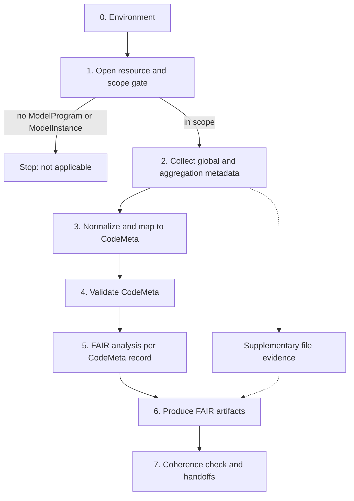

# HydroShare FAIR Assessment Process (Model Programs and Model Instances)

> Process asset for the `fair` skill. Use it when the research object is a HydroShare resource **that contains a ModelProgram or ModelInstance aggregation**. It describes the process only. It is not an assessment result, and nothing here has been run against any particular resource.

| Parameter | Value |
|-----------|-------|
| `RESOURCE_ID` | The 32-character HydroShare resource identifier (the last path segment of the resource URL). Required. |
| Output location | `omf-artifacts/fair/` |
| Access mode | Anonymous, read-only |

## 1. Principles

1. **Scope: model resources only.** The process applies only when the resource holds at least one ModelProgram or ModelInstance aggregation (Step 1). Otherwise stop and report that it does not apply.
2. **`hsclient` is the only collection path.** Read HydroShare metadata and file information with the [`hsclient`](https://pypi.org/project/hsclient/) Python library. Do not scrape landing pages or hand-write REST calls. Landing pages render mostly unpopulated UI templates and can show values (for example "no keywords") that the metadata does not support.
3. **Keep two metadata scopes apart.** *Global* metadata describes the whole resource. *Aggregation* metadata describes one aggregation (a grouping of files with its own metadata). Every collected value carries its scope, and so does every CodeMeta property built from it (section 3).
4. **Download the minimum.** A FAIR assessment needs metadata and file listings, and at most a small README. It does not need the data. Log every content download with its reason.
5. **Crosswalk first.** Resource-level metadata is mapped with the `FAIRRS-Evaluation` crosswalk `crosswalks/codemeta_hs_model_instance.md`. Aggregation-level metadata has no upstream crosswalk, so use the proposed one in Step 3 and label it as such.
6. **The CodeMeta records are what is analysed.** Derive FAIR findings from CodeMeta. Record file-level facts as supplementary observations that are not scored.
7. **Keep observed, inferred and unknown separate.** Tag each claim `Observed`, `Inferred` or `Unknown`. Never fill a missing value. A value copied from the global scope into an aggregation record is `Inferred` until the aggregation says it.

`FAIRRS-Evaluation` is an external repository (<https://github.com/CUAHSI/FAIRRS-Evaluation>). This process needs a local checkout of it. If it is not available, record that as a blocked step and stop after Step 1. Do not reconstruct the crosswalk from memory.



## 2. Steps

### Step 0: Environment

- Create a virtual environment inside the workspace (`python3 -m venv`) and install `hsclient` from PyPI. Record the installed `hsclient` and `hsmodels` versions.
- Network hosts needed, each of which needs user approval: `pypi.org` and `files.pythonhosted.org` (install) and `www.hydroshare.org` (collection).
- Use anonymous access (`HydroShare()` with no credentials). Do not call any write method. If the resource is private or discoverable only, the request fails with a 401. Record the resource as blocked and do not ask for credentials unless the user offers them.
- The evaluator's `environment.yml` pins Python 3.10 and a `hsclient` git branch. Use the PyPI release by default. Switch to the pinned branch only if the PyPI release mishandles file paths that contain spaces, and record why.

### Step 1: Open the resource and apply the scope gate

1. Open the resource with `HydroShare().resource(RESOURCE_ID)`. This reads the resource map and the global metadata (`res.metadata`). It does not download data.
2. Load the aggregations with `res.aggregations()`. Each aggregation exposes its own metadata as `agg.metadata`. Its `type` is an `AggregationType`. The in-scope values are `ModelProgram` (`AggregationType.ModelProgramAggregation`) and `ModelInstance` (`AggregationType.ModelInstanceAggregation`). Other values (`Generic`, `FileSet`, `GeoFeature`, `GeoRaster`, `NetCDF`, `TimeSeries`, `RefTimeseries`, `CSV`) are out of scope.
   - `hsclient` has no way to read an aggregation's type without loading its metadata, so this call requests one small metadata file per aggregation (in a thread pool). Resources with hundreds of aggregations make hundreds of requests. Log the aggregation count and elapsed time. If the count is large, tell the user before proceeding.
   - Filter by `agg.metadata.type` in Python rather than relying on the keyword filters of `aggregations()`.
   - Aggregations can contain further aggregations (every aggregation has its own `aggregations()` method, for example FileSets). Descend into them and de-duplicate by `agg.metadata.url`.
   - Use public attributes (`agg.metadata`, `agg.files()`). Do not use `_retrieved_metadata` or other underscore attributes. They are unset until the metadata has been loaded.
3. Decide scope.
   - **In scope:** at least one aggregation of type `ModelProgram` or `ModelInstance`. Continue.
   - **Not in scope:** none found. **Stop.** Report the aggregation types and counts that were observed, state that this process does not apply, and write no artifacts from it. If a FAIR Management Plan is being produced for other reasons, add the resource to the Research Object Inventory with the note "no ModelProgram or ModelInstance aggregation; HydroShare model process not applied", and continue under the skill's general workflow.
   - **Cannot decide:** the call raised an error. Aggregation metadata that fails `hsmodels` validation can raise `pydantic.ValidationError` from the whole call, because `hsclient` loads every aggregation's metadata to build typed aggregations (observed in the upstream query script, which catches it). Record the scope as `Unknown`, report the error, and do not guess. A 401 means the resource is not anonymously readable (see Step 0).

Legacy HydroShare "Model Program Resource" or "Model Instance Resource" types are not aggregations and do not satisfy the gate.

### Step 2: Collect global and aggregation metadata

Write everything to one raw snapshot (for example `omf-artifacts/fair/raw/hydroshare-snapshot.json`) with a retrieval timestamp and the `hsclient` and `hsmodels` versions. Every later step reads the snapshot, so the network is not used again. Keep the two scopes in separate sections:

```json
{
  "retrieved_at": "...",
  "versions": {"hsclient": "...", "hsmodels": "..."},
  "scope_gate": {"aggregation_count": 0, "type_counts": {}, "in_scope": true},
  "global": {"metadata": {}, "system_metadata": {}, "files": []},
  "aggregations": [
    {"url": "...", "type": "ModelProgram", "parent": null, "metadata": {}, "files": []}
  ],
  "other_aggregations": [{"url": "...", "type": "...", "title": "..."}],
  "downloads": []
}
```

**Global scope (whole resource):**

| What | Accessor | Notes |
|------|----------|-------|
| Descriptive metadata (title, abstract, creators, contributors, subjects, rights, relations, funding, coverage, dates) | `res.metadata` | An `hsmodels` object. Check attribute names against the installed `hsmodels` version. |
| System metadata (created, modified, status, owner, resource type) | `res.system_metadata()` | JSON from the sysmeta endpoint. |
| Resource file listing | `res.files()` | `path`, `name`, `extension`, `folder`, `checksum` (MD5), `url`. There is **no size attribute**. Record sizes as `Unknown`. |

**Aggregation scope (each ModelProgram and ModelInstance aggregation):**

| What | Accessor | Notes |
|------|----------|-------|
| Aggregation metadata | `agg.metadata` | Serialize with the pydantic model's `model_dump(mode="json")`. Fields are listed in Step 3. |
| Aggregation files | `agg.files()` | Same `File` attributes as above, and also no size. |
| Aggregation location | `agg.metadata.url`, `agg.metadata_path` | `url` is the aggregation's own HydroShare URL. |

For all other aggregation types, store only `type`, `url` and `title` under `other_aggregations`. They are context for the inventory and are not crosswalked.

Do not use these:

- `res.download()`, `folder_download`, `file_download`, `aggregation_download` and `agg.as_data_object()` (content downloads). One small README download is allowed only when a stated question needs it.
- Every write or structural method: `save`, `delete`, `file_upload`, `file_aggregate`, `aggregation_remove`, `aggregation_move`, `aggregation_delete`, `set_sharing_status`, and similar.

Rules:

- **Exclude author email addresses and other unnecessary personal data** from the snapshot. Keep profile URLs and ORCID identifiers. Aggregation metadata has no creator fields, but `additional_metadata` is free text, so check it before storing.
- Record each content download (file, size, reason) under `downloads`.

### Step 3: Normalize and map to CodeMeta

Build one CodeMeta record for the resource (global scope) and one for each in-scope aggregation. A ModelProgram is software, so its record is a CodeMeta `SoftwareSourceCode`. A ModelInstance is a configured model run (inputs, and optionally outputs). CodeMeta fits it only loosely, and the report must say so.

**3.1 Global scope: strict resource record.** The crosswalk and `schemas/hydroshare/hydroshare2codemeta.py` use HydroShare discovery-style field names (`title`, `abstract`, `authors`, `short_id`, `link`, `availability`, `owner`, and so on). `hsclient` exposes differently named attributes, so write a small adapter that renames the global snapshot fields. Then apply `codemeta_hs_model_instance.md` as written, with no aggregation values. Output: `codemeta-resource-strict.json`.

| HydroShare (global) | CodeMeta |
|---|---|
| `title` | `name` |
| `abstract` | `description` |
| `author`, `authors` | `author` |
| `author_link`, `short_id` | `identifier` |
| `contributor` | `contributor` |
| `subject` | `keywords` |
| `type` | `applicationCategory` |
| `link` | `codeRepository` |
| `created`, `modified` | `dateCreated`, `dateModified` |
| `availability` | `license` |
| `owner` | `maintainer` |
| `availabilityurl`, `geo` | no CodeMeta target |

**3.2 Aggregation scope: proposed crosswalk.** `FAIRRS-Evaluation` has no crosswalk for aggregation metadata. The upstream file named `codemeta_hs_model_instance.md` covers only the global fields above. The table below is therefore a **proposal** derived from the `hsmodels` aggregation field definitions and CodeMeta 3.0 terms. Label every output built from it `extended`, and report it upstream as a suggested crosswalk.

Fields common to every aggregation type (`hsmodels` `BaseAggregationMetadataIn` plus `type`, `url`, `rights`):

| Aggregation field | CodeMeta | Basis | Note |
|---|---|---|---|
| `title` | `name` | Direct | If absent, inherit the resource title and tag it `Inferred`. |
| `subjects` | `keywords` | Direct | |
| `rights` (use `rights.url`; keep `rights.statement` as evidence) | `license` | Direct | Takes precedence over any resource-level licence for this record. Keep the URL. Add an SPDX identifier only for an exactly matching well-known licence URL, tagged `Inferred`. |
| `url` | `identifier` | Direct | The aggregation's own HydroShare URL. It is not a DOI. The resource DOI belongs to the whole resource. |
| `type` | `applicationCategory` | Direct | `ModelProgram` or `ModelInstance`. |
| `language` | no CodeMeta target | | This is the metadata language, not a programming language. |
| `additional_metadata` | no CodeMeta target | | Free-text key-value pairs. Keep in the snapshot. A key named `Description` may feed `description` in the extended record, tagged `Inferred`. |
| `spatial_coverage`, `period_coverage` | no CodeMeta target | | Same gap as the resource-level `geo`. Report it as supplementary evidence. |

ModelProgram fields (`ModelProgramMetadata`):

| Aggregation field | CodeMeta | Basis | Note |
|---|---|---|---|
| `version` | `softwareVersion` | Direct | |
| `programming_languages` | `programmingLanguage` | Direct | |
| `operating_systems` | `operatingSystem` | Direct | |
| `release_date` | `datePublished` | Inferred | CodeMeta has no release-date term. Report the choice. |
| `code_repository` | `codeRepository` | Direct | The real source repository. See issue F. |
| `website` | `url` | Direct | A site maintained by the model developers. |
| `file_types` (each entry has a `type` and a `url`) | `type` `modelSoftware` or `modelEngine`: `downloadUrl`. `modelDocumentation`: `softwareHelp`. `modelReleaseNotes`: `releaseNotes`. | Inferred | The four `ModelProgramFileType` terms were read from `hsmodels` source. Check them against the installed version. Check that `codemeticulous` accepts `softwareHelp` and `releaseNotes` as written. |
| `program_schema_json` | no CodeMeta target | | A machine-readable parameter schema. Record it as supplementary evidence. |

ModelInstance fields (`ModelInstanceMetadata`):

| Aggregation field | CodeMeta | Basis | Note |
|---|---|---|---|
| `executed_by` | `softwareRequirements` | Inferred | The URL of the ModelProgram that runs this instance. Resolve it to a ModelProgram aggregation in the same resource by comparing `url` after normalizing scheme (`http` and `https`) and dropping any fragment. If it does not resolve, keep the URL and mark it `external or unresolved`. |
| `includes_model_output` | no CodeMeta target | | The instance also holds results. Say so in the inventory. |
| `program_schema_json`, `program_schema_json_values` | no CodeMeta target | | Machine-readable parameter schema and values. Supplementary evidence. |

**3.3 Inheritance and conflicts (aggregation record).** Aggregation metadata has **no creators, abstract, or created and modified dates** (an abstract exists only for time series). Those can only come from the global scope. Build each aggregation record in this order, and record the origin of every property in a field-origin table (`Aggregation`, `Global-inherited`, or `Unknown`):

1. Use the aggregation's own value when it has a non-empty one.
2. Otherwise inherit from the global scope only for properties the aggregation cannot hold at all: `author`, `contributor`, `maintainer`, `dateCreated`, `dateModified`, `funder`, and the resource DOI. Tag each as `Inferred`. The resource's authors may not be the model's developers. The resource DOI identifies the whole resource, not this aggregation.
3. Never inherit `name`, `softwareVersion`, `codeRepository` or `license` silently. Use the title fallback in 3.2 for `name` (tagged `Inferred`). Leave the others `Unknown`.
4. Where both scopes give a value for the same property (`license`, `keywords`, `codeRepository`), the aggregation record uses the aggregation value. The resource-level value stays in the strict record. List every difference in the report as a conflict. Do not merge keyword lists.

**3.4 Issues to raise rather than resolve silently.**

- **A. `availability` → `license` is a category error.** `availability` is a status such as `published`, not a licence. The strict resource record keeps the crosswalk as written. In aggregation records, use `rights` as above. Report the difference to the crosswalk maintainers.
- **B. The crosswalk named "model instance" holds only global fields.** It has no aggregation-level fields, and nothing for ModelProgram or ModelInstance specifics. 3.2 is the proposal that fills that gap.
- **C. `hydroshare2codemeta.py` has behaviour to avoid.** Verify these against the checked-out version before relying on them.
  - It sets `codeRepository` to the HydroShare base URL, not the resource URL.
  - It builds `identifier` only when `availability` is `["published"]`.
  - It leaves `license` unset.
  - It adds a `review` ("Reviewed and accepted for publication in HydroShare") to every published resource. That claim has no supporting evidence and would make the R3 check pass wrongly. **Do not carry it over.**
- **D. Useful global fields have no crosswalk entry.** These are `funder`, related resources (`isBasedOn` or `relatedLink`), `citation`, `datePublished`, `fileSize` and `hasPart`. Add them only to extended records, each marked as an extension.
- **E. Aggregation-level fields lack identity and credit.** There is no creator, date, or persistent identifier at aggregation scope (3.3). Report this as a limit of the source metadata, not as a defect of the resource.
- **F. `codeRepository` has two meanings.** The global crosswalk puts the HydroShare landing page there. A ModelProgram aggregation's `code_repository` is the actual source repository. In the aggregation record, use the aggregation value. Put the resource landing page in `relatedLink` (check that `codemeticulous` accepts it) and keep `codeRepository` unset if the aggregation has no repository. Tag any fallback `Inferred`.
- **G. Upstream precedent is partial.** `schemas/hydroshare/utils/query_hydroshare_repository.py` already reads ModelProgram aggregation fields with `hsclient`. It keeps only the first ModelProgram (marked as a TODO), reads a private attribute, and signs in interactively. Do not copy those behaviours.

Outputs: `codemeta-resource-strict.json` (global, crosswalk as written) and one `codemeta-aggregation-<n>.json` per in-scope aggregation (extended). Name each file in the inventory by the aggregation's `url`. Report the records separately and do not merge them.

### Step 4: Validate

Validate every record with `codemeticulous`, the validator the evaluator uses. If a record fails validation, report the error and do not score it.

### Step 5: FAIR analysis on the CodeMeta records

Analyse each record separately. A ModelProgram, a ModelInstance and the resource that contains them are different research objects.

**5a. Property coverage (primary).** Use `crosswalks/codemeta_fairmetrics.md`. For each FAIR metric (FM-F1A to FM-R1.3), record which CodeMeta properties are present, empty or absent in each record. For each property, also record its scope (`Global`, `Aggregation`, `Global-inherited`). Output: a metric-by-property table per record.

**5b. `fair4rs_comses` evaluator.** Run it as `python main.py --file <codemeta.json> --output <dir>` from `evaluators/fair4rs_comses`. It needs `codemeticulous`, `pydantic`, `requests` and `pandas`. Include these caveats in the report:

- The indicators are written for **software**, so they fit ModelProgram records best. For ModelInstance and resource records, I1, R2 and R3 mostly do not apply. Report them as *not applicable / not evidenced*, not as failures.
- Defects observed in the evaluator source, to work around without editing it (log each workaround):
  - `evalR1_1` indexes `license["name"]` and fails when `license` is absent.
  - `evalR2` returns a bare value, not a `(result, log)` tuple.
  - `evalR1_2` is fixed to `False` and has weight 0.
- `evalA1_1` and `evalA1_2` resolve URLs over the network, so results can differ between runs. Record the run date.
- Report weighted scores with the evaluator's weights. Do not present them as a verdict.

**5c. Per-object status.** Add one Research Object Inventory entry for each of: the resource (as the container), every ModelProgram aggregation, and every ModelInstance aggregation. Give each its own Findable, Accessible, Interoperable and Reusable status, based on its own CodeMeta record and file listing. State where a status rests on an inherited (`Global-inherited`) value, because that makes it `Inferred`. In particular, an aggregation has no DOI of its own, so its Findable status depends on the resource DOI plus its aggregation URL. Do not report that as the aggregation having a persistent identifier. Other aggregation types appear only in the notes as context.

**5d. Supplementary observations (not scored).** CodeMeta cannot express some problems. Record them beside the scores, each tagged by confidence:

- Aggregation metadata that is empty where the type expects a value (for example a ModelProgram with no `version`, `code_repository` or `rights`).
- A ModelInstance whose `executed_by` does not resolve to a ModelProgram, and ModelInstances with `includes_model_output` true but no listed output files.
- Presence and reachability of `program_schema_json` and `program_schema_json_values`. Test reachability only if a metadata-only request is enough. Otherwise leave it `Unknown`.
- Spatial and temporal coverage at each scope (no CodeMeta target).
- Files whose checksum or name does not match what the README or metadata describes. Sizes are not available through `hsclient`. If size matters, name the source and mark the finding `Unconfirmed`.
- File names with spaces or other non-portable characters, and documentation in non-machine-readable formats.

For each finding, name the scope the owners would edit to fix it: the resource metadata, or the metadata of a named aggregation.

### Step 6: Produce artifacts

Write under `omf-artifacts/fair/`:

| Artifact | Required | Notes |
|---|---|---|
| `fair-management-plan.md` | Yes | Use `assets/FAIR-MP-TEMPLATE.md`. The Research Object Inventory is canonical and carries the per-object status. |
| `fair-assessment-report.md` | Yes | Per-object detail, the field-origin tables, evaluator logs, caveats and the issues A to G. |
| `codemeta-resource-strict.json`, `codemeta-aggregation-<n>.json` | Yes | Derived from the snapshot. |
| `provenance-manifest.json` | Yes | From `assets/provenance-manifest-template.json`, checked against the schema. |
| `license-inventory.md` | Yes | One row per object. The resource licence and each aggregation licence are listed separately, and differences are flagged. Upstream source terms stay `Unknown` unless stated in the metadata. |
| `stewardship-checklist.md` | Optional | An actionable list for the resource owners, grouped by the scope to edit. |
| `dmp.md` or `smp.md` | Only if a funder requires it | Derive from the FAIR Management Plan. |

Provenance manifest:

- Entities: the snapshot, every CodeMeta file, and each artifact.
- Activities: scope-gate, collect (global), collect (aggregation), normalize, map, validate, evaluate and report.
- Record the versions of `hsclient`, `hsmodels`, `codemeticulous`, the evaluator, and the crosswalk commit. State that the aggregation crosswalk is the proposal in this asset.
- Set `raw_prompt_recorded` to `false`. Add a privacy note that author emails were excluded.

### Step 7: Coherence check and handoffs

- Names, identifiers, licences and dates agree across all artifacts, or each difference is listed as a conflict.
- Every ModelInstance-to-ModelProgram link in the records matches the inventory.
- Other artifacts refer to the inventory and do not redefine objects.
- Every claim carries an `Observed`, `Inferred` or `Unknown` tag. Every inherited value is `Inferred`.
- Nothing implies verification that did not happen. For example, do not state that a DOI resolves unless it was resolved during the run.
- Model structure, parameterization and calibration go to `omfa`. Narrative documentation of the model goes to `document`. Neither is judged here.

## 3. Scope limits

- This is an external review of a deposit and does not assume the authors took part.
- Nothing is changed in the HydroShare resource, the crosswalk, the converter or the evaluator. Report suggested changes only.
- Scientific correctness of the model or data is not assessed.
- Resources without a ModelProgram or ModelInstance aggregation are out of scope for this process.
- Behaviours of `hsclient`, `hsmodels` and the evaluator were read from source. They are `Observed` for the versions that were read and must be re-checked against the installed versions.
- The aggregation crosswalk in 3.2 is a proposal and has not been reviewed by the HydroShare, CodeMeta or FAIRRS-Evaluation maintainers.
